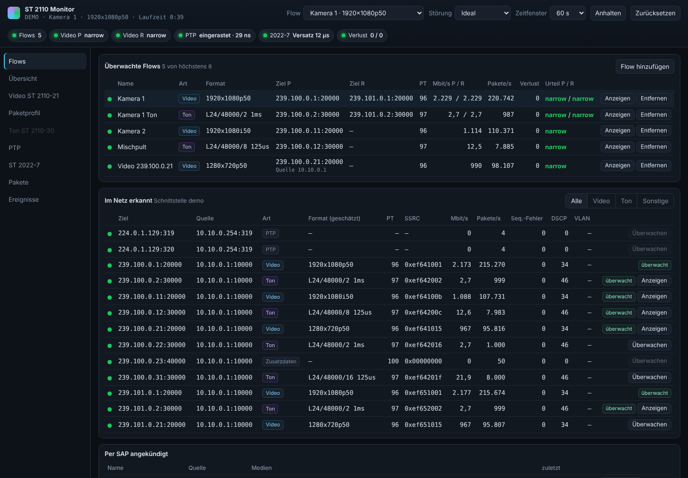
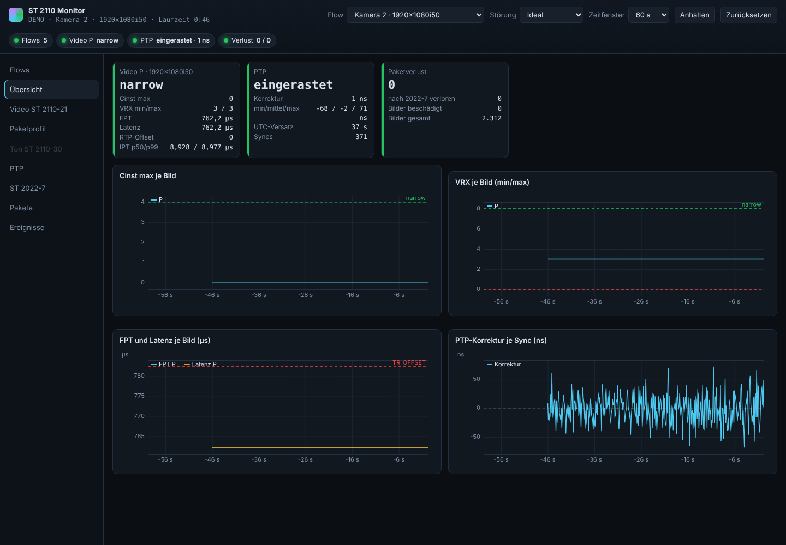
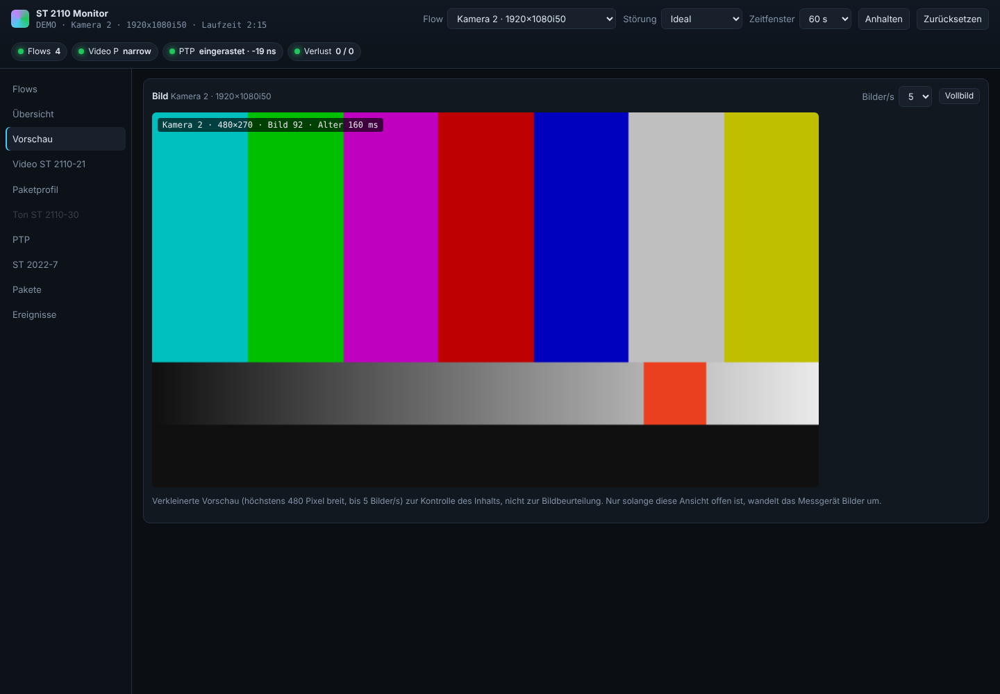
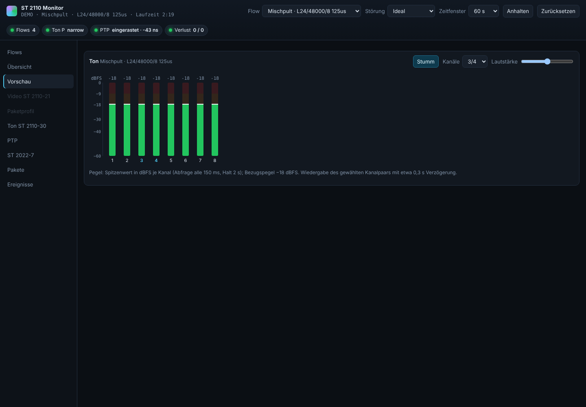
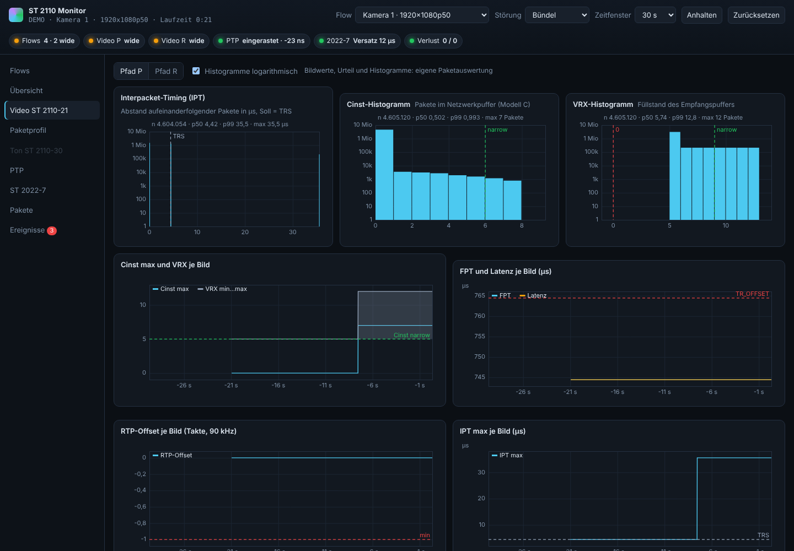
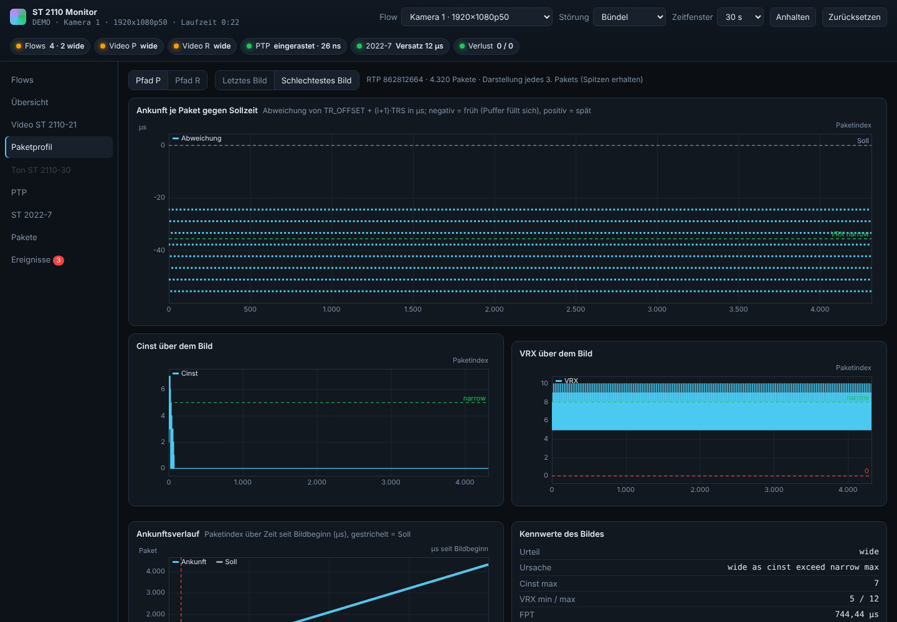

# ST2110 – Messplatz für SMPTE ST 2110

`st2110-monitor` empfängt ST-2110-Flows unter Linux mit der
[Intel Media Transport Library (MTL)](https://github.com/OpenVisualCloud/Media-Transport-Library) und
bewertet sie wie ein Broadcast-Messgerät: Video-Timing nach ST 2110-21, Ton nach ST 2110-30, PTP und
ST 2022-7 für **mehrere Flows gleichzeitig**, dazu die **Erkennung aller Flows im Netz** mit Adressen,
Datenraten und geschätztem Format, mit Web-Oberfläche und JSON-Berichten. Einsatz: Studio und Lehre an der Hochschule Düsseldorf
(HSD), Inbetriebnahme von ST-2110-Geräten, Vorarbeit für ST 2110 im
[Studio-Gateway](https://github.com/raindropmedia/studio-gateway).

**Stand:** Kern, Demo und Oberfläche laufen und sind getestet. Der Empfang über MTL kompiliert und linkt
gegen MTL v26.09 mit eigenem Patch, ist aber **noch nicht auf einer Karte gelaufen**. Messwerte gelten erst
nach dem Abgleich mit EBU LIST als belastbar (`docs/MESSUNGEN.md`).



## Funktionen

Angelehnt an die Ansichten von Telestream PRISM und Phabrix QxL, soweit MTL die Daten liefert:

| Ansicht | Inhalt |
| --- | --- |
| Flows | **Überwachte Flows** (Name, Art, Format, Ziel P/R, Quelle, PT, Datenrate P/R, Pakete/s, Verlust, Urteil; anzeigen, entfernen, hinzufügen per Angabe oder SDP), **im Netz erkannte Flows** (Ziel, Quelle, Art, geschätztes Format, PT, SSRC, Datenrate, Pakete/s, Sequenzfehler, DSCP, VLAN; per Klick überwachen), **per SAP angekündigte Sitzungen** |
| Vorschau | **Bild** des gewählten Videoflows als JPEG (Größe 480 / 960 / voll / UHD, 1–50 Bilder/s, Qualität wählbar, Vollbild, gemessene Bild- und Datenrate) bzw. **Ton** zum Anhören (Kanalpaar wählbar, Lautstärke) mit **Pegelmessern** aller Kanäle in dBFS ([ADR 0006](docs/adr/0006-vorschau.md)) |
| Übersicht | für den in der Kopfzeile gewählten Flow: Kacheln je Pfad mit Urteil narrow/wide/failed, Cinst, VRX, FPT, Latenz, RTP-Offset, IPT; Ton DPVR/TSDF; PTP; 2022-7; Verluste; Verläufe |
| Video ST 2110-21 | **Interpacket-Timing-Histogramm** (IPT, Sollwert TRS), Cinst- und VRX-Histogramm mit narrow/wide-Grenzen, Verläufe je Bild (Cinst, VRX, FPT, Latenz, RTP-Offset, IPT max), Kenngrößen und Grenzwerte, Fehlerursachen |
| Paketprofil | Ankunft **jedes Pakets** eines Bildes gegen die Sollzeit TR_OFFSET + (i+1)·TRS, Cinst und VRX über dem Bild, Ankunftsverlauf; letztes oder schlechtestes Bild |
| Ton ST 2110-30 | DPVR- und IPT-Histogramm, DPVR und TSDF je 200 ms mit Grenzen |
| PTP | Zustand (eingerastet/nicht eingerastet/kein Sync), Korrektur der Kartenuhr je Sync als Verlauf und Histogramm, UTC-Versatz |
| ST 2022-7 | Pfadversatz R − P je Bild (Verlauf, Histogramm), Verluste je Pfad, rekonstruierte Bilder |
| Pakete | Pakete, Rate, Datenrate, Verluste, Umordnung, Duplikate, falsche Payload-Typen/SSRC je Pfad |
| Ereignisse | Urteilswechsel, PTP-Zustand, Paketverluste, beschädigte Bilder mit Zeitstempel |

Alle Ansichten außer „Flows“, „PTP“ und „Ereignisse“ zeigen nur den gewählten Flow; was zur Art des
Flows nicht passt (z. B. Paketprofil bei Ton), ist ausgegraut. Auswahl und Ansicht stehen in der Adresse
(`#tab=video&flow=v1`), Links lassen sich also weitergeben.

Weitere Funktionen: SDP-Import (`--sdp`, alle Medien, DUP-Gruppen ergeben P und R), JSON-Lines-Berichte je Intervall
und als Zusammenfassung, Zurücksetzen und Anhalten der Anzeige, **Demo-Betrieb ohne Karte** mit
umschaltbaren Störungen (Jitter, Bündel, zu spät, Verlust, Pfadversatz, Ton-Jitter, PTP unruhig) für die Lehre;
die Demo simuliert auch weitere Flows im Netz, PTP-Pakete, Zusatzdaten und SAP-Ankündigungen.



| Bildvorschau (Demo-Testbild) | Ton: Pegel und Anhören |
| --- | --- |
|  |  |

| Bündel (wide) im Video-Timing | Paketprofil des schlechtesten Bildes |
| --- | --- |
|  |  |

## Woher die Werte kommen

- **Urteil und Bildwerte:** Timing-Parser von MTL (`st20_rx_tp_meta`, `st30_rx_tp_meta`), also die
  Rechnung, die MTL selbst prüft.
- **Histogramme und Paketprofile:** eigene Auswertung je Paket. Dafür braucht MTL den Patch aus
  `patches/mtl/` (Rückruf `notify_tp_packet` mit PTP-korrigiertem Hardware-Zeitstempel je Paket,
  [ADR 0003](docs/adr/0003-paket-rueckruf-als-mtl-patch.md)). Ohne Patch fehlen nur diese Ansichten.
  Die eigene Auswertung rechnet mit ganzzahligen Zeitabständen; MTL rechnet IPT in `double`, was bei
  heutiger TAI-Zeit auf 256 ns rastert (siehe `docs/MESSUNGEN.md`).
- **PTP:** `ptp_sync_notify` von MTL. Grandmaster-Kennung, Domäne und Pfadverzögerung stellt MTL nicht bereit.
- **Demo:** Ohne MTL-Bilder (Demo) liefert die eigene Auswertung auch Urteil und Bildwerte, mit denselben
  Formeln und Grenzwerten wie MTL (`src/core/VideoTimingModel.cpp`, `AudioPacketAnalyzer.cpp`).

## Bauen

```bash
# Entwicklung (Linux oder macOS, ohne MTL): Kern, Tests, Demo, Oberfläche aus webui/
# Unter macOS fehlt die Flow-Erkennung (--discover, braucht AF_PACKET); Messen nur unter Linux.
cmake --preset dev && cmake --build --preset dev && ctest --preset dev
./build/dev/st2110-monitor --demo          # http://127.0.0.1:8090/

# Messplatz (MTL mit Patch installiert, scripts/install-mtl.sh)
cmake --preset release && cmake --build --preset release && sudo cmake --install build/release
```

## Messen

```bash
sudo st2110-monitor --port 0000:af:00.0 --local-ip 192.168.100.10 \
     --red-port 0000:af:00.1 --red-local-ip 192.168.101.10 \
     --sdp config/local/kamera1.sdp --sdp config/local/pult.sdp \
     --video 239.100.0.11:20000,format=1920x1080i50,name=Kamera 2 \
     --discover eno1 --http 0.0.0.0:8090 --output config/local/messung.jsonl
```

Flows: `--video ip:port[,red=ip:port][,format=1920x1080p50][,pt=96][,source=ip][,red-source=ip][,name=Text]`
und `--audio ip:port[,red=…][,format=L24/48000/2][,ptime=1][,pt=97][,source=…][,name=…]`, beliebig oft;
`--sdp` übernimmt alle Video- und Tonmedien. Weitere Flows zur Laufzeit über die Oberfläche
(höchstens `--max-flows`, Vorgabe 8). 1080i50 ist `format=1920x1080i50` (Halbbilder je Sekunde).
`--help` zeigt alle Optionen.

**Testsender:** Über einen zweiten Port derselben Karte sendet das Programm Testbild (Farbbalken, Grautreppe,
laufendes Quadrat, Blitz zu jeder vollen Sekunde) und Testton (1 kHz links mit EBU-Kennung, 2 kHz rechts, weitere
Kanäle je 500 Hz · Kanalnummer, −18 dBFS). Sender und Empfang laufen in derselben MTL-Instanz und nutzen
dieselbe PTP-Zeit ([ADR 0007](docs/adr/0007-testsender-und-erkennung-am-verwaltungsport.md)). Beide Ports müssen
am selben Netz (Switch mit PTP und IGMP) hängen; ein Kabel direkt zwischen den Ports reicht nicht, weil dann am
Empfangsport kein PTP-Grandmaster ankommt.

Nur der Sendeport wird beim Start angegeben (`--tx-port`, `--tx-local-ip`; `--max-tx-flows` reserviert Queues,
Vorgabe 4). Alles Weitere stellt man im Tab **Testsender** der Oberfläche ein: Video (Auflösung, Bildrate,
Zeilensprung), Ton (Abtastrate 48/96 kHz, 16/24 Bit, 1–64 Kanäle, Paketzeit 125 µs bis 4 ms), Ziel und
Payload-Typ; Anlegen, Starten, Stoppen, Ändern, Löschen. Der Start wartet bei MTL bis zu 3 min auf PTP und läuft
im Hintergrund. Über „Überwachen“ lässt sich der gesendete Strom gleich am Empfangsport messen. Wer will, gibt
Sender schon beim Start vor:

```bash
sudo st2110-monitor --port 0000:01:00.0 --local-ip 192.168.211.100 \
     --tx-port 0000:01:00.1 --tx-local-ip 192.168.211.101 \
     --tx-video 239.211.0.1:20000,format=1920x1080p50 --tx-audio 239.211.0.2:30000,format=L24/48000/2 \
     --video 239.211.0.1:20000,format=1920x1080p50,name=Testbild \
     --audio 239.211.0.2:30000,format=L24/48000/2,name=Testton --http 0.0.0.0:8090
```

**Erkennung:** Im DPDK-Betrieb liest das Programm von selbst auf dem **Verwaltungsport** (Schnittstelle mit der
Standardroute) alle UDP/RTP-Flows mit und empfängt SAP; `--no-discover` schaltet das ab. Mit IGMP-Snooping im
Switch sieht der Verwaltungsport nur SAP und selbst abonnierte Gruppen, für eine vollständige Sicht braucht es
einen Spiegelport. `--discover <schnittstelle>` wählt eine andere **Kernel**-Schnittstelle. Die Karte im DPDK-Betrieb sieht nur abonnierte Flows; für die Erkennung deshalb eine
eigene Schnittstelle an einem Spiegelport (oder ohne IGMP-Snooping) vorsehen
([ADR 0005](docs/adr/0005-mehrere-flows-und-erkennung.md)). Braucht CAP_NET_RAW. Ohne `--port` läuft das
Programm als **reiner Netz-Scanner**, auch ohne MTL: `sudo st2110-monitor --discover eno1`.

**Aussagekraft:** Nur mit Hardware-Zeitstempeln und PTP (beides Vorgabe) sind die Werte belastbar.
`--no-hw-timestamp`, `--no-ptp` und `kernel:`-Ports dienen nur als Funktionstest; die Oberfläche warnt dann.

**Web-Oberfläche:** ohne Anmeldung. Vorgabe ist `127.0.0.1:8090`; im Messnetz nur bewusst mit
`--http 0.0.0.0:8090` freigeben ([ADR 0004](docs/adr/0004-web-oberflaeche-im-programm.md)).

### JSON Lines

| `type` | Inhalt |
| --- | --- |
| `start` | Formate, Adressen, Hardware-Zeitstempel und PTP an/aus |
| `interval` | je Intervall und Flow (`flows.<id>`): je Pfad Urteil, Zähler, Min/Mittel/Max, Histogramm-Kurzform p50/p99/max, Pfadversatz, Zähleränderungen; dazu PTP |
| `summary` | dasselbe über die ganze Messung |

`--output -` schaltet die Berichte ab. Rückgabewerte: 0 = empfangen, 1 = Optionen fehlerhaft,
2 = Start fehlgeschlagen, 3 = nichts empfangen.

### API

| Aufruf | Zweck |
| --- | --- |
| `GET /api/info` | Programmstand, Paket-Rückruf vorhanden, Demo |
| `GET /api/flows` | überwachte, erkannte und per SAP angekündigte Flows, Status der Erkennung |
| `POST /api/flows` | Flow überwachen: `{"kind":"video","spec":"239.1.1.1:20000,format=1920x1080p50"}`, `{"sdp":"v=0…"}` oder `{"sap":"<schlüssel>"}` |
| `DELETE /api/flows/<id>` | Flow nicht mehr überwachen |
| `GET /api/preview/video?flow=v1&width=960&fps=25&quality=80&after=n` | Vorschaubild als JPEG; wartet bis 250 ms auf ein Bild neuer als n (Größe in `X-Preview-Width`/`-Height`, 204 bis zum ersten Bild) |
| `GET /api/preview/audio?flow=a1&from=n&pair=0` | Ton ab Abtastwert n, Kanalpaar als 16 Bit stereo, Pegel aller Kanäle in `X-Audio-Peaks` |
| `GET /api/snapshot?flow=v1&window=60` | Werte, Histogramme, Verläufe und Profile eines Flows, PTP, Ereignisse, Flow-Liste |
| `GET /api/tx` | Testsender: Sendeport, Höchstzahl, Einträge mit Zustand (`stopped`, `starting`, `sending`, `stopping`, `error`); `{"available": false}` ohne `--tx-port` |
| `POST /api/tx` | Testsender anlegen: `{"kind":"audio","spec":"239.211.1.1:30000,format=L24/48000/8,ptime=125us","start":true}` (spec wie `--tx-video`/`--tx-audio`) |
| `PUT /api/tx/<id>` | Einstellungen ändern (`{"spec":"…"}`), nur im Zustand `stopped` oder `error` |
| `POST /api/tx/<id>/start`, `POST /api/tx/<id>/stop` | Senden starten (im Hintergrund, MTL wartet auf PTP) bzw. beenden |
| `DELETE /api/tx/<id>` | Testsender löschen |
| `POST /api/reset` | Messwerte zurücksetzen |
| `GET/POST /api/demo` | Störung der Demo abfragen bzw. setzen (`{"preset": "burst"}`) |

## Hardware

Referenz ist die **Intel E830-XXVDA2** (geliefert mit E830-L-Controller, `8086:12de`), siehe
[ADR 0002](docs/adr/0002-netzwerkkarte-e830.md) und [Inbetriebnahme](docs/hardware/e830-xxvda2.md).
`scripts/check-e830.sh` prüft den Rechner, `scripts/setup-host.sh` richtet Hugepages und Ports ein.

## Dokumentation

- [Architekturentscheidungen](docs/adr/README.md)
- [Inbetriebnahme E830-XXVDA2](docs/hardware/e830-xxvda2.md)
- [Messungen und offene Prüffragen](docs/MESSUNGEN.md)

## Lizenz

Noch festzulegen. MTL steht unter BSD-3-Clause; der Patch in `patches/mtl/` ändert MTL-Quelltext und
folgt dessen Lizenz.
